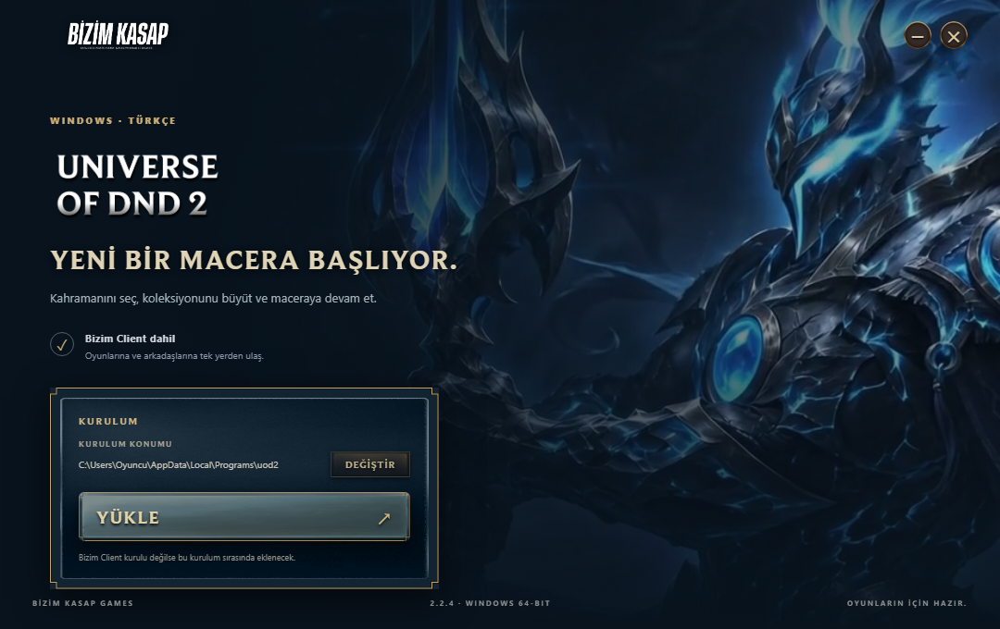

# Universe of DnD 2

Güncel Windows sürümü: **2.2.4**. Mevcut UoD2 yayın deposu üzerinden dağıtılır.

**[UoD2'yi indir](https://github.com/ATOStudios/uod2/releases/latest/download/UOD2-Setup.exe)** · [Son sürüm](https://github.com/ATOStudios/uod2/releases/latest)

Windows 10/11, 64 bit. Kurulum internet bağlantısı gerektirir. Özel UoD2 kurulum ekranı gerekli dosyaları indirip doğrular. Bizim Client kurulu değilse önce onu kurar. Oyun Bizim Client üzerinden açılır.

1. Kurulumu aç ve **YÜKLE** düğmesine bas.
2. Tamamlandıktan sonra **BAŞLAT** ile Bizim Client'i aç.
3. Discord hesabınla giriş yapıp UoD2'yi başlat. Mevcut hesap erişimi Kasap Discord topluluğu üyeliği gerektirir.

Yarım kalan indirmeler yeniden çalıştırıldığında devam edebilir. Mevcut oyuncu kayıtları korunur. Bu yayında oyun içeriği güncel yerel 2.2.4 kaynaklarından derlenmiştir.

Kurulumlar şu anda yayıncı sertifikasıyla imzalı değildir; Windows yayıncıyı doğrulayamayabilir.

[Bizim Client](https://github.com/ATOStudios/BizimClient) · [Legends of Aetheria](https://github.com/ATOStudios/loa)
